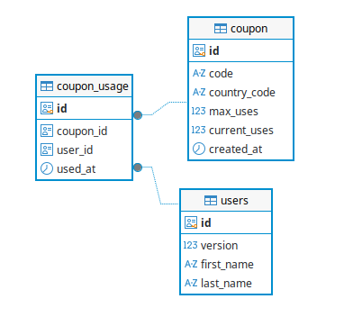
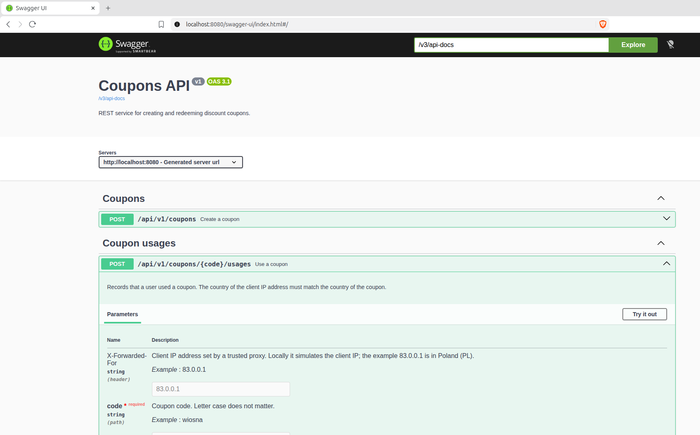
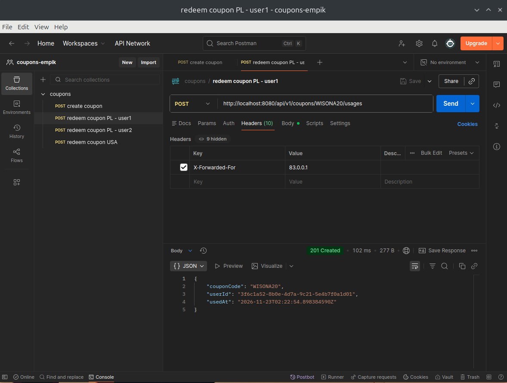
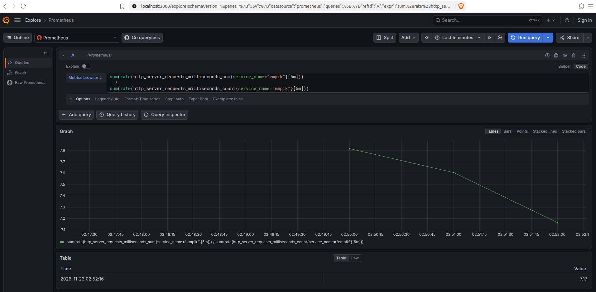

# Coupons

REST service for creating and redeeming discount coupons.

## How it works

The service lets you create discount coupons and lets users redeem them.

**Create a coupon** with `POST /api/v1/coupons`. You choose a code, a country and how many times the coupon can be used.
Letter case in the code does not matter: `WIOSNA` and `wiosna` are the same coupon.

**Redeem a coupon** with `POST /api/v1/coupons/{code}/usages` and the id of the user. The service checks the request before it accepts it:

| Check | Answer when the check fails |
|---|---|
| Does the coupon exist? | 404 |
| Does the user exist? | 404 |
| Does the request come from the coupon's country? The service reads the country from the client IP address. | 403 |
| Has the user already used this coupon? | 409 |
| Are there any uses left? | 409 |

When many users redeem the same coupon at the same time, the first ones win and the coupon is never used more times than allowed.
[docs/decisions/](docs/decisions/) explains how the service guarantees this and why it looks up countries in a local file.

## Database schema



[docs/database-schema.md](docs/database-schema.md) describes the tables, columns and constraints.

## IP geolocation

The service finds the country of an IP address in the DB-IP Lite database file `geoip/dbip-country-lite-YYYY-MM.mmdb`.
The repository contains the file, so the service works right after cloning.
DB-IP publishes a new file every month, usually on the 1st.
Every day at 04:00 UTC and at startup, the service downloads the file of the current month when it is missing and deletes the older file.
The `coupons.geoip` properties in `application.yaml` configure the directory and the download.

[IP Geolocation by DB-IP](https://db-ip.com) is licensed under [CC BY 4.0](https://creativecommons.org/licenses/by/4.0/).

## Development

Requires JDK 25 and Docker.

### Run in IntelliJ

In **Run → Edit Configurations… → CouponsApplication**, set **Active profiles** to `dev`, then run `CouponsApplication`.
Postgres starts automatically in Docker from `compose.yaml`.

### Run from the command line

```bash
./mvnw spring-boot:run -Dspring-boot.run.profiles=dev
```

### API documentation

Swagger UI is available at http://localhost:8080/swagger-ui.html while the application runs.
The OpenAPI document is available at http://localhost:8080/v3/api-docs.
The `prod` profile turns both off.



### Postman collection

[coupons.postman_collection.json](coupons.postman_collection.json) holds example requests to the application running locally on port 8080 with the `dev` profile.
Import it in Postman with **File → Import**.

The collection creates a coupon for Poland and uses it from Poland by two users and from the USA by one user.
The requests use the two users that the `dev` profile inserts and set the client IP address in the `X-Forwarded-For` header:

| `X-Forwarded-For` | Country |
|---|---|
| `83.0.0.1` | Poland (`PL`) |
| `8.8.8.8` | USA (`US`) |



### Health checks

`/actuator/health/liveness` reports whether the application is running.
`/actuator/health/readiness` reports whether the application can serve requests. It reports DOWN while no DB-IP Lite file is loaded.
Kubernetes can use them as the liveness and readiness probes.

### Metrics, traces and logs

The `dev` profile sends metrics and traces of every request to Grafana at http://localhost:3000 (login `admin`/`admin`).
Grafana runs in the `lgtm` service from `compose.yaml`, together with Prometheus (metrics) and Tempo (traces).

Example query in Grafana Explore showing the average response time in milliseconds over the last 5 minutes:

```promql
sum(rate(http_server_requests_milliseconds_sum{service_name="empik"}[5m]))
  /
sum(rate(http_server_requests_milliseconds_count{service_name="empik"}[5m]))
```



### Conventions

[docs/conventions.md](docs/conventions.md) describes how the project documents the API with OpenAPI, names methods, handles exceptions, logs, uses mappers and writes and organizes tests.

### Useful commands

Run unit tests:

```bash
./mvnw test
```

Run unit and integration tests (classes ending with `IT`):

```bash
./mvnw verify
```

Remove the Postgres container together with its data:

```bash
docker compose down -v
```

## Production notes

Rate limiting on prod is worth adding.
Without it, a client can guess coupon codes by sending many requests to `POST /api/v1/coupons/{code}/usages`.
Set the limit per client IP in the ingress or API gateway, for example with `limit_req` in nginx.
A limit inside the application would need a shared counter store, for example Redis, because every pod counts its own requests.
