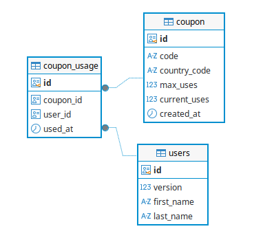

# Database schema

Liquibase migrations in `src/main/resources/db/changelog/changes/` define the schema.

## `users`

The `users` table stores the users who redeem coupons.

| Column       | Type           | Description                                                     |
|--------------|----------------|-----------------------------------------------------------------|
| `id`         | `UUID`         | It is the primary key.                                          |
| `version`    | `BIGINT`       | JPA uses it for optimistic locking (`@Version` in `User`).      |
| `first_name` | `VARCHAR(100)` | It holds the user's first name.                                 |
| `last_name`  | `VARCHAR(100)` | It holds the user's last name.                                  |

## `coupon`

The `coupon` table stores one row per coupon code.

| Column         | Type          | Description                                                                                                  |
|----------------|---------------|--------------------------------------------------------------------------------------------------------------|
| `id`           | `UUID`        | It is the primary key.                                                                                       |
| `code`         | `VARCHAR(64)` | It holds the coupon code. The code is unique and stored in uppercase, so `wiosna` and `WIOSNA` are the same. |
| `country_code` | `VARCHAR(2)`  | It holds the country where the coupon can be used, as an ISO 3166-1 alpha-2 code (for example `PL`).         |
| `max_uses`     | `INT`         | It holds the maximum number of redemptions.                                                                  |
| `current_uses` | `INT`         | It holds the number of redemptions so far.                                                                   |
| `created_at`   | `TIMESTAMPTZ` | It holds the creation time of the coupon.                                                                    |

Constraints:

- `CHECK (max_uses > 0)` requires every coupon to allow at least one redemption.
- `CHECK (current_uses >= 0 AND current_uses <= max_uses)` keeps the redemption counter within the limit.

## `coupon_usage`

The `coupon_usage` table stores one row per redemption.

| Column      | Type          | Description                                          |
|-------------|---------------|------------------------------------------------------|
| `id`        | `UUID`        | It is the primary key.                               |
| `coupon_id` | `UUID`        | It references `coupon.id`.                           |
| `user_id`   | `UUID`        | It references `users.id`.                            |
| `used_at`   | `TIMESTAMPTZ` | It holds the redemption time.                        |

Constraints:

- `UNIQUE (coupon_id, user_id)` lets a user redeem a given coupon only once.
